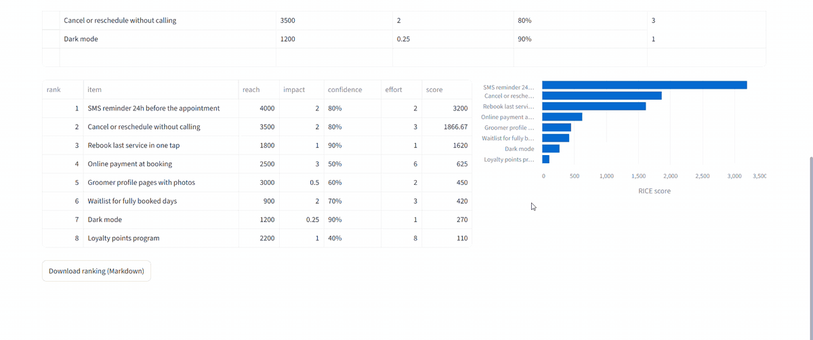
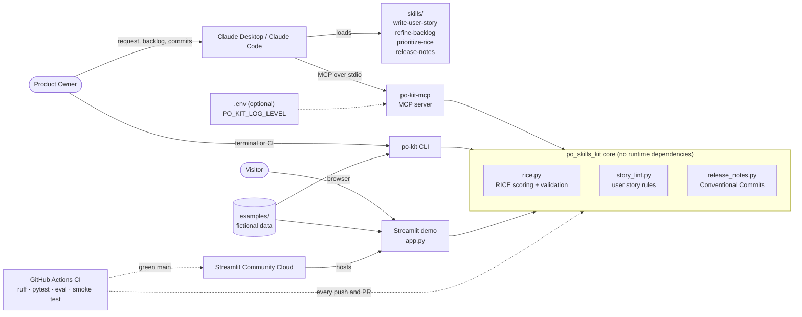

# 🧭 PO Skills Kit

[](https://github.com/rafauto/po-skills-kit/actions/workflows/ci.yml)
[](pyproject.toml)
[](LICENSE)
[](#project-status-and-roadmap)
[](https://po-skills-kit.streamlit.app/)

Claude skills for Product Owners, plus a small MCP server that does the checking and the math. You use them to write user stories, refine a backlog, prioritize with RICE and draft release notes.

**Live demo:** [po-skills-kit.streamlit.app](https://po-skills-kit.streamlit.app/). It runs without an account or an API key, using fictional data.



## Why I built this

As a Product Owner I use Claude every day for backlog work. Improvised prompts gave me stories of uneven quality and RICE scores that changed between runs, and I still wrote release notes by hand every sprint. This kit packages that work as reusable skills, and it moves everything that has a right answer (formulas, rules, grouping) into tested Python code. The result is consistent artifacts I can defend in front of stakeholders. The examples use only fictional data.

## Features

- **4 Claude skills** (`skills/`), written as structured prompts with steps, templates and guardrails:
  - `write-user-story`: turns a raw request into a story with Given/When/Then acceptance criteria.
  - `refine-backlog`: finds duplicates, oversized items and missing criteria, then proposes splits and questions.
  - `prioritize-rice`: produces a reproducible RICE ranking, explains the top 3 and flags items that are sensitive to Confidence.
  - `release-notes`: turns commits into notes for customers, internal teams or stakeholders.
- **MCP server** (`po-kit-mcp`) with 3 deterministic tools: `score_rice`, `lint_story` and `build_release_notes`.
- **CLI** (`po-kit rice | lint | notes | demo`), which also works in CI pipelines.
- **Streamlit demo** with the same tools: you can edit the backlog, paste a story or paste commits.
- **Guardrails:** input limits, validation that reports every problem with its row number, and an instruction in every skill to treat pasted content as data, not instructions.
- **Offline eval** that measures the skill output against the quality rules.

## Example output / Results

`po-kit demo` on the fictional backlog of a pet grooming booking app (`examples/`):

| Rank | Item | Reach | Impact | Confidence | Effort | RICE score |
|---:|---|---:|---:|---:|---:|---:|
| 1 | SMS reminder 24h before the appointment | 4000 | 2 | 80% | 2 | 3,200.00 |
| 2 | Cancel or reschedule without calling | 3500 | 2 | 80% | 3 | 1,866.67 |
| 3 | Rebook last service in one tap | 1800 | 1 | 90% | 1 | 1,620.00 |
| … | … | … | … | … | … | … |
| 8 | Loyalty points program | 2200 | 1 | 40% | 8 | 110.00 |

```text
FAIL  03-needs-work.md  (score 45/100, 2 scenario(s))
  - [warning] specific-role: The role 'user' is generic; name the persona (e.g. 'returning customer').
  - [warning] single-goal: The goal contains 'and'; it may be two stories. Consider splitting it.
  - [error] complete-scenario: Scenario 2 is missing: When.
  - [warning] testable-language: Vague wording is hard to test: properly, quickly. Use observable outcomes.
```

**Eval results** (`tests/test_eval.py`, measured on v0.1.0):

| Check | Result |
|---|---|
| Drafts from the `write-user-story` skill that pass the linter (target ≥ 8/10) | **10/10** |
| Average quality score of those drafts | **98/100** (2 drafts with a `single-goal` warning) |
| Labeled stories where the linter flags exactly the known problems | **10/10** |
| Test suite: 58 tests (unit, MCP integration, eval, app smoke test) | offline, no API key; the 57 non-UI tests run in **under 2 s** |

The most useful finding came from the eval. Two drafts reported "lint_story 100/100" in their own notes, but the linter found a warning in each. A model's self-assessment is not a check, and this is why the kit runs the check in code ([ADR 0001](docs/decisions/0001-llm-writes-code-checks.md)). The drafts are recorded outputs from Claude following the skill. They are kept unchanged in `tests/fixtures/eval/`.

## Tech stack

| Area | Tools |
|---|---|
| Language | Python 3.10+ (core library with no runtime dependencies) |
| AI integration | Claude skills (`SKILL.md`), Model Context Protocol Python SDK v2 |
| Interfaces | argparse CLI, MCP server over stdio, Streamlit + Altair + pandas |
| Quality | pytest, Ruff (lint and format), offline eval |
| Automation | GitHub Actions (Python 3.10 and 3.12), Dependabot, Dev Container |
| Deploy | Streamlit Community Cloud |

## Architecture / How it works



In Claude, a skill guides the conversation (it asks for the persona, drafts the story, explains the ranking). Whenever there is a right answer, the skill calls a tool on the local MCP server. The CLI and the Streamlit demo call the same core modules, so one test suite covers every interface. Image version: [`docs/architecture.png`](docs/architecture.png), source: [`docs/architecture.mmd`](docs/architecture.mmd).

**Design decisions**

- [ADR 0001](docs/decisions/0001-llm-writes-code-checks.md): the LLM writes, deterministic code checks and calculates.
- [ADR 0002](docs/decisions/0002-one-package-three-interfaces.md): one package with three thin interfaces, not separate services.
- [ADR 0003](docs/decisions/0003-mcp-sdk-v2-stdio.md): official MCP SDK v2 over stdio, so there is no hosting and no authentication.

## Project structure

```text
po-skills-kit/
├── skills/                    # The 4 Claude skills (SKILL.md each)
├── src/po_skills_kit/
│   ├── rice.py                # RICE scoring, validation and Markdown table
│   ├── story_lint.py          # User story quality rules and score
│   ├── release_notes.py       # Conventional Commits -> release notes
│   ├── cli.py                 # po-kit command
│   └── mcp_server.py          # po-kit-mcp server (stdio)
├── app.py                     # Streamlit demo
├── examples/                  # Fictional backlog, stories, commits, Claude Desktop config
├── tests/                     # Unit, integration (MCP), eval and app smoke tests
│   └── fixtures/              # Recorded skill drafts and labeled linter cases
├── docs/
│   ├── architecture.mmd/.png  # Architecture diagram
│   ├── decisions/             # ADRs
│   └── screenshots/           # README GIF and screenshots
├── .github/                   # CI, Dependabot, issue and PR templates
├── .devcontainer/             # Reproducible development environment
├── pyproject.toml             # Package, extras, Ruff and pytest configuration
└── requirements.txt           # Only for Streamlit Community Cloud
```

## Getting started

**Prerequisites:** Python 3.10+ and Git. Claude Desktop or Claude Code is needed only for the skills.

```bash
git clone https://github.com/rafauto/po-skills-kit.git
cd po-skills-kit
python -m venv .venv
source .venv/bin/activate           # Windows: .venv\Scripts\activate
pip install -e ".[mcp,app]"         # add ",dev" to run the tests
po-kit demo                         # check that everything works
```

No API key is needed. `.env.example` lists the only optional setting, the MCP server log level.

### Add the skills to Claude

- **Claude Code:** copy the folders into your skills directory: `cp -r skills/* ~/.claude/skills/`.
- **Claude apps:** zip each folder (`cd skills && zip -r write-user-story.zip write-user-story`) and upload it in the Skills section of Claude's settings.

### Connect the MCP server

- **Claude Code:** `claude mcp add po-skills-kit -- "$(pwd)/.venv/bin/po-kit-mcp"`
- **Claude Desktop:** add the entry from [`examples/claude_desktop_config.json`](examples/claude_desktop_config.json) to your `claude_desktop_config.json` with the absolute path to `po-kit-mcp`, then restart Claude Desktop.

## Usage

**In Claude** (skills + MCP server):

> Write a user story for this request: "Customers keep calling to move their grooming appointments, can they do it in the app?"

> Prioritize these items with RICE: … (paste the table from `examples/backlog.csv`)

**In the terminal:**

```bash
po-kit rice examples/backlog.csv            # Markdown ranking (add --json for JSON)
po-kit lint examples/stories/*.md           # exit code 1 if any story has errors
git log --oneline v1.3.0..HEAD > commits.txt
po-kit notes commits.txt --version v1.4.0 --output RELEASE_NOTES.md
```

**Demo app:** `streamlit run app.py`, then open http://localhost:8501.

## Running the tests

```bash
pip install -e ".[dev,mcp,app]"
pytest                    # all tests, offline, no API key
ruff check .              # lint
ruff format --check .     # formatting
po-kit demo               # end-to-end smoke test, same as the CI
```

## Deployment

The demo runs on Streamlit Community Cloud from the `main` branch. CI must pass before anything is merged into `main`. To publish your own copy:

1. Fork the repository.
2. On [share.streamlit.io](https://share.streamlit.io), choose **Create app**, select the fork, branch `main` and file `app.py`.
3. Deploy. No secrets are needed, and `requirements.txt` installs the package and the app dependencies.

## Project status and Roadmap

**Status:** MVP (`v0.1.0`). The main flow works end to end in Claude, the CLI and the demo.

- [x] 4 skills: user stories, backlog refinement, RICE and release notes
- [x] MCP server with 3 tools, tested over the real protocol
- [x] CLI, Streamlit demo and offline eval
- [ ] WSJF as an alternative to RICE
- [ ] Definition of Ready template that the team can configure
- [ ] Export ready stories as GitHub issues
- [ ] Sprint goal skill
- [ ] Publish on PyPI

## Limitations / Privacy

- The linter checks form, not value. It cannot tell whether a story is worth building.
- The `single-goal` rule flags any "and" in the goal, so phrases like "drag and drop" produce a warning to review, not an error.
- The skills need a Claude plan with skills enabled. The tools are free to run and have no usage costs.
- **Privacy:** all example data is fictional. The tools run locally or in the demo and do not store or send what you type. Do not paste real customer or personal data into issues.

## Contributing

Contributions are welcome. See [CONTRIBUTING.md](CONTRIBUTING.md) for setup, the pull request flow, commit conventions and guiding principles.

## License

[MIT](LICENSE) © 2026 Rafaela Uto

## Author

**Rafaela Uto**, Product Owner working on digital products, data and generative AI.
GitHub: [@rafauto](https://github.com/rafauto)
